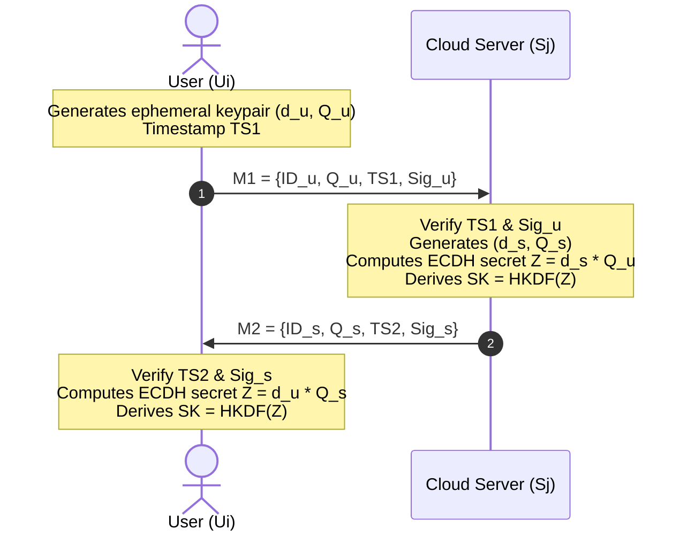
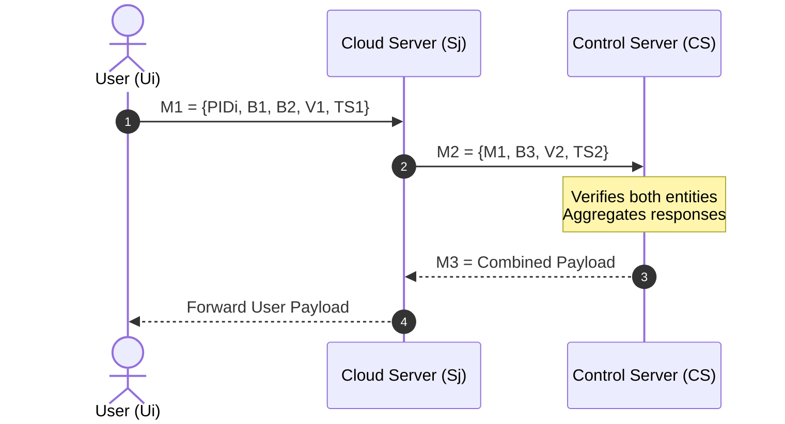

# Protocol Specifications & Normalization Details

This document details the mathematical models, cryptographic primitives, operational flows, and normalization choices for the three authentication and key agreement protocols evaluated in **CryptoMAKA Lab**:

1. **Ju-Park 2023** (Faithful Normalized Reconstruction)
2. **ECC/ECDH Counterpart** (Modern Asymmetric Benchmark)
3. **Proposed Reduced-Round-Trip Extension** (Experimental 3-Message Flow)

---

## 1. Ju-Park (2023) Protocol (Normalized Reconstruction)

### 1.1 Reference and Attribution
- **Source:** Ju, S.; Park, Y. *"Provably Secure Lightweight Mutual Authentication and Key Agreement Scheme for Cloud-Based IoT Environments."* *Sensors*, 2023, 23(24), 9766. DOI: [10.3390/s23249766](https://doi.org/10.3390/s23249766).
- **Architecture Model:** Three-tier architecture consisting of:
  - **User / IoT Device ($U_i$)**: Resource-constrained node with smart card ($SC_i$).
  - **Cloud Server ($S_j$)**: Semi-trusted service provider delivering edge or cloud IoT services.
  - **Control Server ($CS$)**: Trusted root authority managing identity registration and key derivation.

### 1.2 Mathematical Notation & Primitives
- $H(\cdot)$: Cryptographic hash function. Normalized to length-prefixed SHA-256 producing 256-bit ($32\text{ bytes}$) digest output.
- $\oplus$: Bitwise exclusive-OR (XOR) operation.
- $\parallel$: Concatenation operator.
- $x_{CS}$: Master secret key possessed exclusively by $CS$.
- $ID_i, ID_j, ID_{CS}$: Permanent unique identity strings of User $U_i$, Cloud $S_j$, and Control Server $CS$.
- $PID_i$: Dynamic pseudo-identity of User $U_i$, updated after every successful session.
- $PW_i, BIO_i$: User password and biometric credentials.
- $\text{Gen}(\cdot), \text{Rep}(\cdot)$: Fuzzy extractor generation and reproduction algorithms ($\text{Gen}(BIO_i) \to (\sigma_i, \tau_i)$).
- $r_i, r_j, r_k$: Cryptographically secure 256-bit ephemeral random nonces chosen by $U_i, S_j,$ and $CS$.
- $TS_1, TS_2, TS_3, TS_4$: Unix epoch timestamps used for transmission freshness validation ($\Delta T \le 30\text{ s}$).

### 1.3 Normalization Assumptions
In Section 4 of Ju & Park (2023), several figures (notably Figures 4 and 6) exhibit notation and parameter dimension discrepancies:
1. **Bit-Width Alignment:** Expressions such as $(r_k \parallel r_i) \oplus H(\dots)$ combine values with mismatched bit widths if unexpanded. In our implementation, keystreams are derived deterministically using counter-mode SHA-256 expansion (`xor_stream`) to avoid arbitrary truncation.
2. **Fixed-Size Hashes:** All pseudo-identities, secret masks, and verification tokens are standardized to 256-bit output blocks, ensuring clean, byte-aligned XOR masking without security degradation.
3. **Published Communication Value:** The theoretical communication overhead of $3,776\text{ bits}$ reported in the paper is preserved as an academic reference metric; the normalized executable payload measures $4,224\text{ bits}$.

### 1.4 Detailed Protocol Flow (4 Messages)

```mermaid
sequenceDiagram
    autonumber
    actor U as User (Ui)
    participant S as Cloud Server (Sj)
    participant CS as Control Server (CS)

    Note over U: Login: Computes ri, TS1, B1, B2, V1
    U->>S: M1 = {PIDi, B1, B2, V1, TS1}
    Note over S: Verify TS1; Generates rj, TS2, B3, V2
    S->>CS: M2 = {M1, B3, V2, TS2}
    Note over CS: Verify TS1, TS2, V1, V2<br/>Generates rk, TS3, B6-B9, V3, V4, new_PID
    CS->>S: M3 = {B6, B7, B8, B9, V3, V4, TS3, new_PID}
    Note over S: Verify TS3, V3; Computes SK<br/>Prepares M4
    S->>U: M4 = {B8, B9, V4, TS3, TS4, new_PID}
    Note over U: Verify TS4, V4; Computes SK<br/>Updates PIDi <- new_PID
```

#### Step-by-Step Equations:

1. **User Login & $M_1$ Generation:**
   - Reproduce biometric secret: $\sigma_i = \text{Rep}(BIO_i, \tau_i)$
   - Recover credentials:
     $$k_i = A_1 \oplus H(ID_i \parallel H(PW_i \parallel \sigma_i))$$
     $$SID_i = A_2 \oplus H(\sigma_i \parallel PW_i)$$
   - Generate fresh nonce $r_i$ and timestamp $TS_1$:
     $$B_1 = r_i \oplus H(SID_i \parallel ID_{CS} \parallel k_i)$$
     $$B_2 = H(ID_j) \oplus H(ID_{CS} \parallel SID_i \parallel r_i)$$
     $$V_1 = H(ID_{CS} \parallel TS_1 \parallel SID_i \parallel k_i \parallel r_i)$$
   - Transmit: $M_1 = \{PID_i, B_1, B_2, V_1, TS_1\}$ to Cloud Server $S_j$.

2. **Cloud Server Relay ($M_2$):**
   - Check freshness: $|T_{now} - TS_1| \le \Delta T$
   - Generate fresh nonce $r_j$ and timestamp $TS_2$:
     $$B_3 = r_j \oplus H(k_j \parallel ID_j)$$
     $$V_2 = H(k_j \parallel TS_2 \parallel ID_j \parallel r_j)$$
   - Transmit: $M_2 = \{M_1, B_3, V_2, TS_2\}$ to Control Server $CS$.

3. **Control Server Verification & Response ($M_3$):**
   - Verify timestamps $TS_1, TS_2$.
   - Lookup $PID_i$ to recover $(ID_i, k_i, SID_i, n_i)$.
   - Extract $r_i = B_1 \oplus H(SID_i \parallel ID_{CS} \parallel k_i)$ and verify $V_1$.
   - Verify cloud identity $ID_j$, extract $r_j = B_3 \oplus H(k_j \parallel ID_j)$, and verify $V_2$.
   - Generate nonce $r_k$, timestamp $TS_3$, and dynamic ticket $PID_i^*$:
     $$PID_i^* = PID_i \oplus H(PID_i \parallel r_k \parallel r_i)$$
     $$B_6 = (r_k \parallel r_i) \oplus H(r_j \parallel k_j)$$
     $$B_7 = SID_i \oplus H(SID_j \parallel r_k)$$
     $$B_8 = (r_j \parallel r_k) \oplus H(SID_i \parallel ID_{CS} \parallel r_i)$$
     $$B_9 = SID_j \oplus H(SID_i \parallel r_k)$$
     $$C_1 = H((SID_i \oplus SID_j) \parallel ID_{CS})$$
     $$V_3 = H(SID_j \parallel r_k \parallel r_i \parallel C_1 \parallel TS_3)$$
     $$V_4 = H(SID_i \parallel r_j \parallel r_k \parallel C_1 \parallel TS_3)$$
   - Transmit: $M_3 = \{B_6, B_7, B_8, B_9, V_3, V_4, TS_3, PID_i^*\}$ to Cloud $S_j$.

4. **Cloud Verification & User Finalization ($M_4$):**
   - Cloud verifies $V_3$, extracts nonces, derives session key:
     $$SK = H(C_1 \parallel r_i \parallel r_j \parallel r_k)$$
   - Forwards $M_4 = \{B_8, B_9, V_4, TS_3, TS_4, PID_i^*\}$ to User $U_i$.
   - User verifies $V_4$, derives $SK$, and updates local pseudo-identity $PID_i \leftarrow PID_i^*$.

---

## 2. ECC/ECDH Counterpart Protocol

### 2.1 Design Objectives
- **Standard Baseline:** Modern asymmetric comparative benchmark using industry-standard primitives.
- **Standards Employed:** NIST P-256 (SECP256R1), Ephemeral Diffie-Hellman (ECDH), and HKDF-SHA256 (RFC 5869).

### 2.2 Protocol Flow (2 Messages)



### 2.3 Characteristics:
- **Round-trips:** 1 round-trip (2 messages), direct peer-to-peer.
- **Forward Secrecy:** Yes; ephemeral private keys $d_u, d_s$ are discarded after key agreement.
- **Overhead:** Higher computational cost due to point multiplications on elliptic curves, lower control complexity (no online third-party server during authentication).

---

## 3. Proposed Reduced-Round-Trip Extension

### 3.1 Design Rationale
- **Disclaimer:** **Proposed Extension — Not part of Ju-Park (2023).**
- **Objective:** Evaluate potential round-trip reduction in edge architectures where the Cloud Server acts purely as a pass-through proxy.
- **Mechanism:** Control Server directly formats and encapsulates the response for User $U_i$ within an optimized 3-message flow.



### 3.2 Evaluation Summary
- **Latency Advantage:** Eliminates internal processing latency between Cloud and Control Server on the return path.
- **Security Trade-off:** Requires careful binding to prevent split-view attacks where Cloud and User verify different control server sessions.

---

## 4. Protocol Specification Comparison Matrix

| Property | Ju-Park 2023 (Normalized) | ECC/ECDH Counterpart | Reduced-Round-Trip (Proposed) |
|---|---|---|---|
| **Round Trips** | 2 (4 messages) | 1 (2 messages) | 1.5 (3 messages) |
| **Primary Primitives** | SHA-256, XOR, Nonces | ECDH (P-256), HKDF | SHA-256, XOR, Nonces |
| **Root Authority** | Online ($CS$) | Offline PKI / Preshared | Online ($CS$) |
| **Anonymity & Pseudonymity** | Dynamic $PID_i$ update | Static/Ephemeral ID | Dynamic $PID_i$ update |
| **Forward Secrecy** | Ephemeral nonces ($r_i, r_j, r_k$) | Ephemeral DH keys | Ephemeral nonces |
| **Theoretical Comm. Cost** | 3,776 bits (published) | 1,664 bits | ~2,944 bits |
| **Normalized Measured Cost** | 4,224 bits | 1,664 bits | 3,136 bits |
